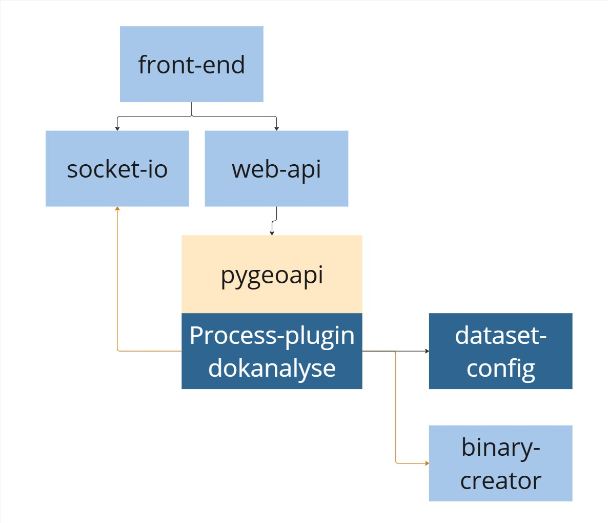

# Arealanalyse av DOK-datasett
Demonstrator for oppsett av arealanalyse basert på pygeoapi

## Forutsetninger for installasjon i eget miljø
- [Docker](https://www.docker.com/)
- [Docker Compose](https://docs.docker.com/compose/)
- [Git](https://git-scm.com/)

Disse verktøyene er nødvendige for å bygge og kjøre applikasjonen i et containerisert miljø.


## Komponenter i løsningen


## Last ned demonstratorprosjektet
Start med å laste ned demonstratorprosjektet som inneholder front-end, socket-io og web-api.

```bash
git clone https://github.com/kartverket/DOK.Arealanalyse.Demonstrator.git
cd DOK.Arealanalyse.Demonstrator
```

## Last ned konfigurasjonsfiler
Last ned konfigurasjonsfiler for analyseoppsett mot datasettene i DOK.

```bash
git clone https://github.com/kartverket/DOK.Arealanalyse.Config.git
cd DOK.Arealanalyse.Config
```

### Kjøre applikasjonene i docker 
```bash
docker-compose up --build
```

## Last ned pygeoapi med plugin for DOK arealanalyse
```bash
git clone --branch main https://github.com/kartverket/DOK.Arealanalyse.Pygeoapi.git
cd DOK.Arealanalyse.Pygeoapi
```
### Justere konfigurasjonen til ditt miljø
juster miljøvariabler i prosjektet

```ini
PYGEOAPI_CONFIG=/pygeoapi/local.config.yml
PYGEOAPI_API_URL=http://localhost:5000/
DOKANALYSE_APP_FILES_DIR=/mnt/dokanalyse
DOKANALYSE_CONFIG_DIR=/mnt/dokanalyse/config
DOKANALYSE_AR5_FGDB_PATH=
DOKANALYSE_BLOB_STORAGE_CONN_STR=
DOKANALYSE_SOCKET_IO_SRV_URL=http://host.docker.internal:5002/
```
### Kjøre applikasjonene i docker 
```bash
docker-compose up --build
```

## Tjenestestatus (helsesjekk)
Web-api-et sjekker jevnlig tjenestene som DOK-analysen er avhengig av, og front-end viser resultatet på `/status`. Datasettene leses fra konfigurasjonsfilene i [DOK.Arealanalyse.Config](https://github.com/kartverket/DOK.Arealanalyse.Config) på GitHub, så nye eller endrede konfigurasjonsfiler blir med i neste kjøring.

For hvert datasett sjekkes det at datatjenesten (WFS, ArcGIS REST eller OGC API) og WMS-en svarer, at lagene finnes, at egenskapene i `properties`, `geom_field` og feltene i `filter` finnes i skjemaet, og at en intersect-spørring mot et testområde fungerer. I tillegg sjekkes Geolett-id-ene, metadata i Kartkatalogen og de andre registrene og API-ene som Process og web-api-et bruker. Resultatene lagres i en SQLite-database.

```ini
HEALTHCHECK_ENABLED=true                     # kjør helsesjekken som bakgrunnsjobb i web-api-et
HEALTHCHECK_INTERVAL_MINUTES=15
HEALTHCHECK_CONFIG_REF=main                  # branch i konfigurasjonsrepoet (main = produksjon, staging = staging)
HEALTHCHECK_DB_PATH=/data/healthcheck/healthcheck.db
HEALTHCHECK_RETENTION_DAYS=90                # hvor lenge resultatene beholdes
HEALTHCHECK_DETAILS_RETENTION_DAYS=7         # hvor lenge detaljene (manglende egenskaper o.l.) beholdes
HEALTHCHECK_SLOW_THRESHOLD_MS=5000
HEALTHCHECK_REQUEST_TIMEOUT=30
```

Helsesjekken kan også kjøres manuelt, for eksempel for å teste en endring i konfigurasjonen:

```bash
cd client/api/src
uv run --project .. python -m dokanalyse-web-api.services.healthcheck --no-store --only-problems --ref staging
```

## Markedsplass
Beskrivelse av tjenesten som er ihht GaiaX for evt publisering av tjenesten i dataspace/markedsplass

[](./gaia-x/self-description.json)
